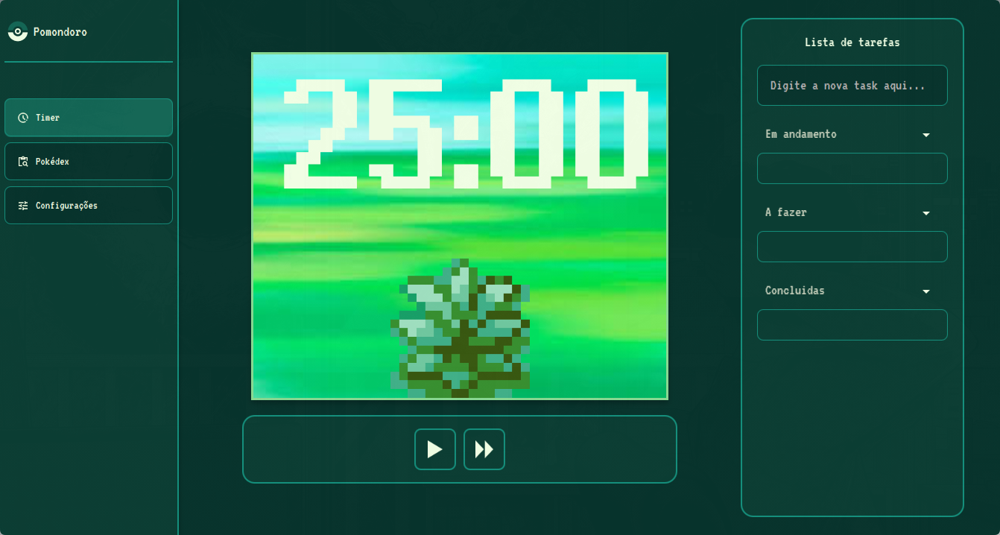
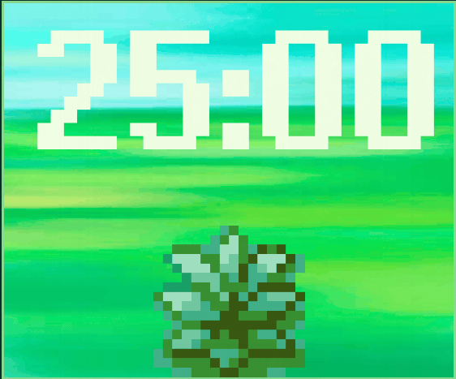
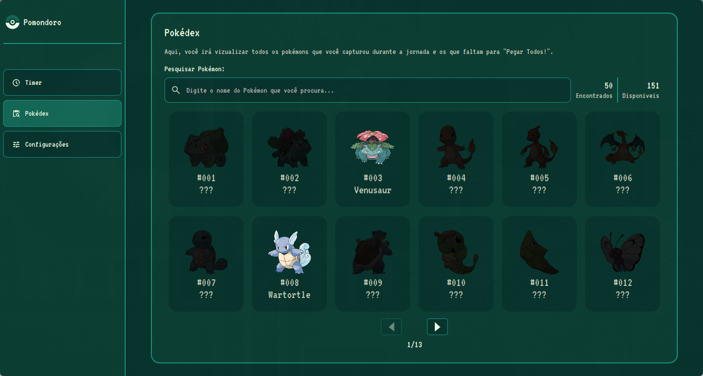

<p align="center">
  
</p>

<p align="center">
  
  
  
  
   
</p>

---

## 📖 Sobre o Projeto

O **Pomondoro App** combina a técnica de gerenciamento de tempo **Pomodoro** com o engajamento e a nostalgia de colecionar Pokémon. 

A cada ciclo de foco completado com sucesso, o usuário é recompensado com a oportunidade de capturar um novo Pokémon para a sua coleção, desbloqueando suas informações em uma Pokédex interativa integrada diretamente à **PokéAPI**.


https://github.com/user-attachments/assets/ac26c552-2a9d-4036-bbd7-ce8433a51ca5


| Tela do Timer | Modo Widget Compacto | Pokédex |
| :---: | :---: | :---: |
|  |  |  |

---

## ✨ Principais Funcionalidades

- **⏱️ Ciclos Pomodoro Customizáveis:**
  - Ajuste personalizado de tempo de foco, pausa curta e pausa longa.
  - Alertas sonoros nostálgicos inspirados nos jogos clássicos de Pokémon.
- **🌱 Gamificação Ativa:**
  - Animação interativa da grama balançando e sons temáticos durante a sessão de foco.
  - Sorteio e recompensa de Pokémon inéditos a cada ciclo finalizado.
- **📱 Pokédex Integrada:**
  - Catálogo dos primeiros 151 Pokémon com busca por nome ou número.
  - Janela de detalhes com sprites animados, tipos coloridos, peso, altura e categoria.
  - Consumo assíncrono de dados da [PokéAPI](https://pokeapi.co/) via requisições HTTP sem travar a interface gráfica.
- **📐 Interface Responsiva (Modo Widget):**
  - Layout dinâmico que se adapta ao redimensionamento da janela.
  - Modo minimalista compacto para deixar no canto da tela enquanto você trabalha ou estuda.
- **💾 Salvamento Automático:**
  - Progresso da sua coleção persistido localmente em formato JSON (`userSave.json`).

---

## 🛠️ Tecnologias e Ferramentas

- **Linguagem:** [Java 23](https://openjdk.org/)
- **Interface Gráfica:** [JavaFX 21](https://openjfx.io/) (FXML + CSS customizado)
- **Gerenciador de Dependências:** [Apache Maven](https://maven.apache.org/)
- **Serialização de Dados:** [Google Gson](https://github.com/google/gson)
- **API Externa:** [PokéAPI v2](https://pokeapi.co/)
- **Testes Automatizados:** [JUnit 5](https://junit.org/junit5/) & [Mockito](https://site.mockito.org/)

---

## 📦 Download do Aplicativo                                                                                                  
                                                                                                             
   - 🪟 **[Download para Windows (.zip)](https://github.com/lukxsz/PomondoroApp/releases/latest)**:         
  Descompacte e execute o arquivo app.bat.                                              
  - 🐧 **[Download para Linux (.zip)](https://github.com/lukxsz/PomondoroApp/releases/latest)**:           
  Descompacte e execute `./bin/app` pelo terminal ou crie o atalho `.desktop`. 
  
---

## 🚀 Como Executar o Projeto Localmente

### Pré-requisitos
- **Java JDK 23** instalado e configurado no `PATH`.
- **Git** instalado.

### Passo a Passo
**Clone o repositório:**
   ```bash
   git clone https://github.com/lukxsz/PomondoroApp.git
   cd PomondoroApp
   ```
 **Execute a aplicação via Maven Wrapper:**
   - No **Linux / macOS**:
     ```bash
     ./mvnw clean javafx:run
     ```
   - No **Windows**:
     ```cmd
     mvnw.cmd clean javafx:run
     ```
---

## Autor

Desenvolvido por **Lukas Grava da Silva**.  
- LinkedIn: [Lukas Grava](https://www.linkedin.com/in/lukasgravadasilva/)  
- GitHub: [@lukxsz](https://github.com/lukxsz)
